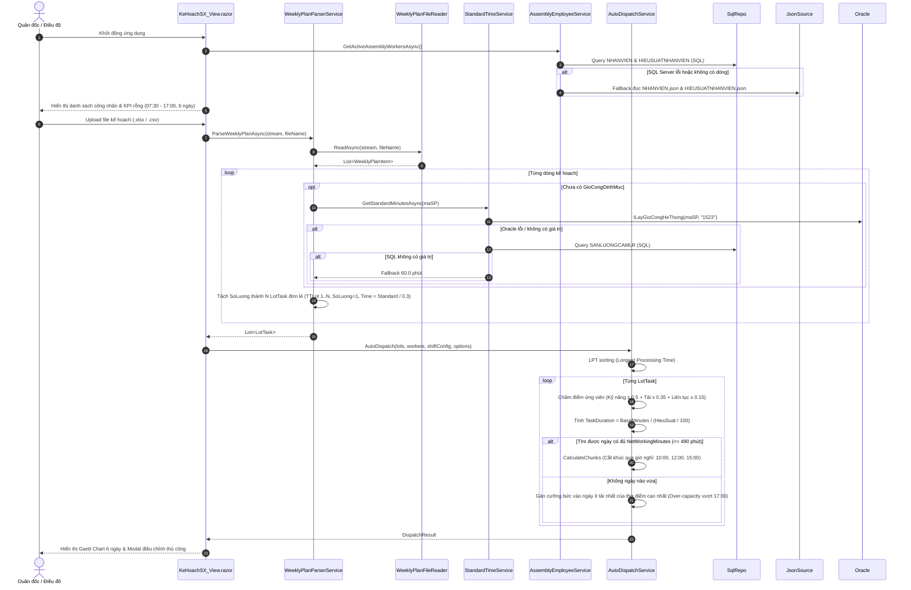

Báo cáo kiểm tra độc lập kiến trúc và mã nguồn repository **KeHoachSX** được thực hiện theo các tiêu chuẩn kỹ thuật của .NET 8, Clean Architecture và tuân thủ các chỉ dẫn trong [AGENTS.md](file:///D:/Drive/Jtec.Modules/LAPRAP/KeHoachSX/AGENTS.md) cũng như các tài liệu đặc tả tại `docs/ai/`.

---

# BÁO CÁO KIỂM TRA ĐỘC LẬP REPOSITORY KEHOACHSX
*(Independent Architectural & Code Review Report)*

---

## 1. Hiện trạng đã kiểm tra (Verified Architecture & Implementation)

### 1.1 Cấu trúc Solution và phân tầng thực tế
Solution `KeHoachSX.sln` gồm 6 project nội bộ và 3 project phụ thuộc bên ngoài (`JtecShare`):

1. **[`KeHoachSX.Core`](file:///D:/Drive/Jtec.Modules/LAPRAP/KeHoachSX/KeHoachSX.Core/KeHoachSX.Core.csproj)** (`net8.0`):
   - Chứa domain models: [`ShiftConfig`](file:///D:/Drive/Jtec.Modules/LAPRAP/KeHoachSX/KeHoachSX.Core/Models/KeHoachSXModels.cs#L10), [`LotTask`](file:///D:/Drive/Jtec.Modules/LAPRAP/KeHoachSX/KeHoachSX.Core/Models/KeHoachSXModels.cs#L63), [`AssemblyWorker`](file:///D:/Drive/Jtec.Modules/LAPRAP/KeHoachSX/KeHoachSX.Core/Models/KeHoachSXModels.cs#L90), [`DispatchResult`](file:///D:/Drive/Jtec.Modules/LAPRAP/KeHoachSX/KeHoachSX.Core/Models/KeHoachSXModels.cs#L128), [`DispatchOptions`](file:///D:/Drive/Jtec.Modules/LAPRAP/KeHoachSX/KeHoachSX.Core/Models/KeHoachSXModels.cs#L149).
   - Tệp [`ProductionPlanner.cs`](file:///D:/Drive/Jtec.Modules/LAPRAP/KeHoachSX/KeHoachSX.Core/Models/ProductionPlanner.cs): Chứa các model thừa/chưa được liên kết (`ProductionInput`, `WorkerEfficiency`, `AssignedWorker`).
2. **[`KeHoachSX.Application`](file:///D:/Drive/Jtec.Modules/LAPRAP/KeHoachSX/KeHoachSX.Application/KeHoachSX.Application.csproj)** (`net8.0`):
   - Chứa Interfaces và Contracts: [`IKeHoachSXServices.cs`](file:///D:/Drive/Jtec.Modules/LAPRAP/KeHoachSX/KeHoachSX.Application/Interfaces/IKeHoachSXServices.cs), [`RepositoryAndSourceInterfaces.cs`](file:///D:/Drive/Jtec.Modules/LAPRAP/KeHoachSX/KeHoachSX.Application/Abstractions/RepositoryAndSourceInterfaces.cs).
   - Core Services:
     - [`WeeklyPlanParserService.ParseWeeklyPlanAsync`](file:///D:/Drive/Jtec.Modules/LAPRAP/KeHoachSX/KeHoachSX.Application/Services/WeeklyPlanParserService.cs#L20): Chuyển đổi dữ liệu thô thành `LotTask`, tự động tách số lượng thành các Lot đơn lẻ (`SoLuong = 1`), áp dụng hệ số tạm thời `standardMinutes / 0.3`.
     - [`AutoDispatchService.AutoDispatch`](file:///D:/Drive/Jtec.Modules/LAPRAP/KeHoachSX/KeHoachSX.Application/Services/AutoDispatchService.cs#L18): Thuật toán xếp lịch tự động theo tuần 6 ngày (Thứ 2 – Thứ 7), tính điểm ứng viên dựa trên Kỹ năng (50%), Cân bằng tải (35%), Tính liên tục mã hàng (15%).
     - [`AssemblyEmployeeService.GetActiveAssemblyWorkersAsync`](file:///D:/Drive/Jtec.Modules/LAPRAP/KeHoachSX/KeHoachSX.Application/Services/AssemblyEmployeeService.cs#L29): Lấy danh sách công nhân đủ điều kiện từ SQL Server, dự phòng bằng JSON nếu SQL lỗi hoặc rỗng.
     - [`StandardTimeService.GetStandardMinutesAsync`](file:///D:/Drive/Jtec.Modules/LAPRAP/KeHoachSX/KeHoachSX.Application/Services/StandardTimeService.cs#L23): Bộ đệm in-memory tra cứu định mức theo thứ tự: Cache -> Oracle -> SQL Server -> Mặc định 60.0 phút.
     - [`SkillMatrixService.EnsureLoadedAsync`](file:///D:/Drive/Jtec.Modules/LAPRAP/KeHoachSX/KeHoachSX.Application/Services/SkillMatrixService.cs#L22): Nạp và giữ ma trận kỹ năng từ 2 file CSV trong bộ nhớ.
3. **[`KeHoachSX.Infrastructure`](file:///D:/Drive/Jtec.Modules/LAPRAP/KeHoachSX/KeHoachSX.Infrastructure/KeHoachSX.Infrastructure.csproj)** (`net8.0`):
   - Data Access: [`SqlAssemblyEmployeeRepository`](file:///D:/Drive/Jtec.Modules/LAPRAP/KeHoachSX/KeHoachSX.Infrastructure/Repositories/SqlAssemblyEmployeeRepository.cs#L8), [`SqlStandardTimeRepository`](file:///D:/Drive/Jtec.Modules/LAPRAP/KeHoachSX/KeHoachSX.Infrastructure/Repositories/SqlStandardTimeRepository.cs#L7), [`JsonAssemblyEmployeeSource`](file:///D:/Drive/Jtec.Modules/LAPRAP/KeHoachSX/KeHoachSX.Infrastructure/DataSources/JsonAssemblyEmployeeSource.cs#L7), [`CsvSkillMatrixDataSource`](file:///D:/Drive/Jtec.Modules/LAPRAP/KeHoachSX/KeHoachSX.Infrastructure/DataSources/CsvSkillMatrixDataSource.cs#L7), [`OracleStandardTimeProvider`](file:///D:/Drive/Jtec.Modules/LAPRAP/KeHoachSX/KeHoachSX.Infrastructure/DataSources/OracleStandardTimeProvider.cs#L7), [`WeeklyPlanFileReader`](file:///D:/Drive/Jtec.Modules/LAPRAP/KeHoachSX/KeHoachSX.Infrastructure/DataSources/WeeklyPlanFileReader.cs#L9).
   - DI Registration: [`KeHoachSXRegisterServices.RegisterServices`](file:///D:/Drive/Jtec.Modules/LAPRAP/KeHoachSX/KeHoachSX.Infrastructure/KeHoachSXRegisterServices.cs#L15).
4. **[`KeHoachSX.UI`](file:///D:/Drive/Jtec.Modules/LAPRAP/KeHoachSX/KeHoachSX.UI/KeHoachSX.UI.csproj)** (`net8.0`):
   - Màn hình Blazor chính: [`KeHoachSX_View.razor`](file:///D:/Drive/Jtec.Modules/LAPRAP/KeHoachSX/KeHoachSX.UI/KeHoachSX_View.razor).
5. **[`KeHoachSX.App`](file:///D:/Drive/Jtec.Modules/LAPRAP/KeHoachSX/KeHoachSX.App/KeHoachSX.App.csproj)** (`net8.0-windows`):
   - Desktop Composition Root (Windows Forms + `BlazorWebView`), khởi tạo form chính tại [`KeHoachSXMainForm.cs`](file:///D:/Drive/Jtec.Modules/LAPRAP/KeHoachSX/KeHoachSX.App/KeHoachSXMainForm.cs).
6. **[`KeHoachSX.Api`](file:///D:/Drive/Jtec.Modules/LAPRAP/KeHoachSX/KeHoachSX.Api/KeHoachSX.Api.csproj)** (`net8.0`):
   - **Hiện trạng:** Chỉ là project rỗng chứa file `.csproj` với framework reference `Microsoft.AspNetCore.App`, hoàn toàn chưa có `Program.cs`, Controller hay Minimal API endpoint nào.

---

## 2. Toàn bộ luồng xử lý thực tế (End-to-End Runtime Execution Flow)

---

## 3. Đối chiếu mã nguồn hiện tại với Quy tắc nghiệp vụ mục tiêu

| Tiêu chí / Quy tắc | Hiện trạng trong Code (`[CODE]`) | Yêu cầu mục tiêu từ Chủ dự án (`[OWNER TARGET]`) | Đánh giá sai lệch / Gaps |
| :--- | :--- | :--- | :--- |
| **Phạm vi chu kỳ lịch** | Cố định 6 ngày (Thứ 2 – Thứ 7, index 0..5) trong [`ShiftConfig`](file:///D:/Drive/Jtec.Modules/LAPRAP/KeHoachSX/KeHoachSX.Core/Models/KeHoachSXModels.cs#L14) và UI. | Chu kỳ sản xuất 7 ngày liên tục từ **Thứ Sáu đến Thứ Năm tuần sau**. Mặc định xem Hôm nay, chọn Hôm qua / Cả tuần. | **Chưa triển khai**. Code hoàn toàn chưa có khái niệm `DateOnly` hay tuần Thứ 6 – Thứ 5. |
| **Phạm vi nhập kế hoạch** | Upload 1 file là ghi đè toàn bộ `_currentLots` dùng chung cho toàn bộ công nhân. | Nhập theo từng **Nhóm (LR1..LR4)**. Nhập lại cùng nhóm & ngày/tuần thì **thay thế**, không ghi đè nhóm khác. Toàn tuần là 1 demand pool phân bổ cho 7 ngày. | **Chưa triển khai**. Không phân biệt Nhóm khi import; không có cơ chế demand pool tuần. |
| **Bản chất Số lượng & Lot** | [`WeeklyPlanParserService.cs#L50-L56`](file:///D:/Drive/Jtec.Modules/LAPRAP/KeHoachSX/KeHoachSX.Application/Services/WeeklyPlanParserService.cs#L50-L56) tách thô `SoLuong` thành $N$ bản ghi `LotTask` với `SoLuong = 1`. | Mỗi dòng đóng góp `Số lượng / Số người làm`. Tổng số lượng kế hoạch chuẩn hóa là **317** (tổng thô 542). Hỗ trợ tỷ lệ thập phân giữa các nhóm. | **Sai lệch bản chất**. Code tách đơn lẻ từng máy móc, triệt tiêu khái niệm tổ làm việc nhiều người và tỷ lệ chuẩn hóa. |
| **Quản lý Nghỉ phép (Leave)** | Hoàn toàn không có code, không có bảng liên quan. | Tra cứu bảng `STOCKMANAGEMENT.dbo.thutuchanhchinh` với điều kiện `TRANGTHAI <> 7` để loại trừ công nhân cả ngày tương ứng. | **Chưa triển khai**. Hiện tại công nhân nghỉ phép vẫn bị xếp việc 100%. |
| **Ngày lễ & Tăng ca (Overtime)** | Mọi ngày đều tính ca cố định 07:30 – 17:00 (490 phút ròng). | - Lễ (`TA.dbo.nghile`): Không có ca thường; chỉ ai có Overtime mới làm việc, bắt đầu từ 08:00. - Ngày thường: Tăng ca bắt đầu từ 17:00, cộng thêm `SOGIO * 60` phút. Không lọc status/duyệt ở pha 1. | **Chưa triển khai**. Hoàn toàn chưa tích hợp 2 bảng này từ SQL Server. |
| **Bàn gá / Bộ gá (Jig Constraints)** | Không có model, không có thuộc tính bàn gá, không có file reader cho `dulieubanga.xlsx`. | - Đọc `dulieubanga.xlsx` (Cột B, C, L, N, O). - Quy tắc T (1-2 người), Quy tắc J (2-4 người theo ngưỡng C >= 200, 300, 400). - Cột O: Số bộ gá vật lý = Số tổ độc lập tối đa làm đồng thời. | **Chưa triển khai**. Không có bất kỳ ràng buộc bàn gá nào trong thuật toán hiện tại. |
| **Mục tiêu hiệu suất theo ngày** | Chỉ dùng để tính thời gian chiếm lịch: `base / (HieuSuat / 100)`. | Phải theo dõi song song: 1. Thời gian chiếm lịch thực tế (clock minutes). 2. Mục tiêu giờ công hệ thống: `DailyTarget = ClockMinutes * HieuSuat / 100`. Phân bổ Lot tiệm cận mục tiêu này. | **Chưa triển khai**. Code chưa tính và chưa theo dõi `DailyTargetStandardMinutes`. |
| **Điều chỉnh thủ công (Manual edit)** | [`KeHoachSX_View.razor#L686-L712`](file:///D:/Drive/Jtec.Modules/LAPRAP/KeHoachSX/KeHoachSX.UI/KeHoachSX_View.razor#L686-L712) chỉ gán lại `AssignedWorkerId`, không tính lại thời lượng theo hiệu suất thợ mới, không kiểm tra quá tải. | Cho phép đổi người, thêm/bớt người vào tổ, thay thế người vắng mặt đột xuất; bảo lưu phần đã làm; gán nhãn manual edit; tính lại toàn bộ KPI/Gantt. | **Rất sơ sài và lỗi logic**. Chuyển Lot không cập nhật lại `ThoiGianThucTe` và Chunks, bấm Auto Dispatch lại sẽ xóa sạch can thiệp thủ công. |
| **Lưu trữ & Xuất Excel** | Chỉ chạy In-memory, không có nút Export Excel kết quả. | Không lưu DB ở pha 1; phải hỗ trợ **Export Excel** ra định dạng báo cáo phân bổ chuẩn. | **Chưa triển khai**. Chưa có chức năng Export Excel kết quả. |

---

## 4. Kiểm tra các kết luận thường gặp & Dự đoán điểm Codex có thể bỏ sót hoặc hiểu sai

*(Dựa trên khảo sát codebase, commit history và tài liệu chuẩn bị đối chiếu khi bạn cung cấp Repository Audit Report của Codex)*

1. **Hiểu sai nghiêm trọng về Cột O trong `dulieubanga.xlsx` (Jig Concurrency vs Headcount Cap):**
   - *Lỗi thường gặp:* Coi cột O là "số lượng công nhân tối đa" được làm mã hàng đó (ví dụ O=3 nghĩa là tối đa 3 người làm).
   - *Thực tế nghiệp vụ đã xác nhận:* **O là số bộ bàn gá vật lý**, tương ứng với **số tổ sản xuất độc lập tối đa chạy đồng thời**. Nếu quy tắc T/J xác định mỗi tổ có 3 người, thì O=3 cho phép bố trí $3 \times 3 = 9$ công nhân cùng làm đồng thời trên 3 bộ gá.
2. **Hiểu sai về phép cộng Số lượng Kế hoạch (Raw Sum 542 vs Normalized Total 317):**
   - *Lỗi thường gặp:* Tính tổng sản lượng bằng cách cộng cột `Số lượng` thô trên file kết quả (ra 542 đơn vị).
   - *Thực tế:* Mỗi dòng kết quả chỉ đóng góp `Số lượng / Số người làm`. Tổng sản lượng thực tế đã chuẩn hóa là **317**. Việc cộng thô sẽ làm sai lệch gấp đôi năng lực sản xuất thực tế.
3. **Hiểu sai về tính năng của `KeHoachSX.Api`:**
   - *Lỗi thường gặp:* Báo cáo rằng hệ thống đã có backend REST API hoàn chỉnh cho các client khác tích hợp.
   - *Thực tế:* [`KeHoachSX.Api.csproj`](file:///D:/Drive/Jtec.Modules/LAPRAP/KeHoachSX/KeHoachSX.Api/KeHoachSX.Api.csproj) là một project hoàn toàn rỗng, chưa hề có endpoint hay middleware nào.
4. **Hiểu sai về vai trò của `DispatchOptions`:**
   - *Lỗi thường gặp:* Cho rằng các cờ cấu hình `BalanceWorkload`, `KeepSameProductContinuous`, `PrioritizeExperiencedWorkers` đang điều khiển thuật toán.
   - *Thực tế:* Trong [`AutoDispatchService.cs#L24-L147`](file:///D:/Drive/Jtec.Modules/LAPRAP/KeHoachSX/KeHoachSX.Application/Services/AutoDispatchService.cs#L24-L147), tham số `options` truyền vào **hoàn toàn không được đọc**; thuật toán chạy cố định công thức tính điểm và bỏ qua mọi cờ cấu hình.
5. **Bỏ sót sự bất đồng bộ giữa SQL Server Repository và JSON Fallback Source:**
   - *SQL Server:* [`SqlAssemblyEmployeeRepository.cs#L32`](file:///D:/Drive/Jtec.Modules/LAPRAP/KeHoachSX/KeHoachSX.Infrastructure/Repositories/SqlAssemblyEmployeeRepository.cs#L32) sử dụng `ORDER BY h.[No] DESC` để lấy bản ghi hiệu suất mới nhất.
   - *JSON Source:* [`JsonAssemblyEmployeeSource.cs#L22-L34`](file:///D:/Drive/Jtec.Modules/LAPRAP/KeHoachSX/KeHoachSX.Infrastructure/DataSources/JsonAssemblyEmployeeSource.cs#L22-L34) duyệt mảng theo thứ tự xuất hiện trong file, ghi đè `efficiencies[id] = value` mà không sắp xếp theo `No`, dẫn đến kết quả fallback phụ thuộc vào thứ tự file JSON.
6. **Bỏ sót lỗi thuật toán cắt Chunks vượt giờ ca (`CalculateChunks`):**
   - Khi công nhân bị xếp quá tải vào ngày cuối, [`AutoDispatchService.cs#L298-L306`](file:///D:/Drive/Jtec.Modules/LAPRAP/KeHoachSX/KeHoachSX.Application/Services/AutoDispatchService.cs#L298-L306) tự tạo Chunk kéo dài quá mốc `shift.TotalElapsedMinutesPerDay` (sau 17:00) thay vì đẩy vào danh sách chưa phân bổ hoặc xử lý theo ca làm việc.
7. **Ranh giới an toàn tuyệt đối của Oracle:**
   - Cần khẳng định: Oracle là **chỉ đọc (Read-Only)** thông qua adapter `ILayGioCongHeThong`. Mọi đề xuất phát sinh lệnh ghi (INSERT/UPDATE/DELETE/DDL) vào Oracle đều vi phạm nghiêm trọng quy chuẩn dự án.

---

## 5. Phân tích chuyên sâu các Rủi ro kỹ thuật và nghiệp vụ

### 5.1 Rủi ro Dữ liệu (Data Risks)
- **Chuỗi kết nối và phụ thuộc bên ngoài:** [`KeHoachSX.App.csproj`](file:///D:/Drive/Jtec.Modules/LAPRAP/KeHoachSX/KeHoachSX.App/KeHoachSX.App.csproj#L16-L32) tham chiếu đến file cấu hình `appsettings.json` và project `JtecShare` ở thư mục cha bên ngoài repository (`..\..\..\..\JtecShare`). Nếu môi trường CI/CD hoặc máy lập trình khác không có thư mục này, quá trình build/restore sẽ thất bại.
- **Dữ liệu Overtime trùng lặp:** Bảng `TA.dbo.Overtime` có thể có nhiều dòng cho cùng 1 nhân viên trong 1 ngày với giá trị `SOGIO` khác nhau. Hiện tại chưa có quy tắc phân xử (tie-breaker), nếu tự ý cộng dồn (`SUM`) sẽ gây sai lệch nghiêm trọng giờ làm việc.
- **Rủi ro phân tích chuỗi văn bản (Culture Sensitivity):** Trong [`WeeklyPlanFileReader.cs#L75`](file:///D:/Drive/Jtec.Modules/LAPRAP/KeHoachSX/KeHoachSX.Infrastructure/DataSources/WeeklyPlanFileReader.cs#L75), `CultureInfo.CurrentCulture` được sử dụng để parse giờ công trong Excel, trong khi CSV lại parse kiểu InvariantCulture. Nếu file Excel mở trên máy có định dạng số kiểu tiếng Việt (dấu phẩy thập phân) hoặc tiếng Anh (dấu chấm thập phân) có thể gây lỗi đọc sai giờ định mức.

### 5.2 Rủi ro Phân bổ nhân viên & Tổ đội (Worker & Team Dispatch Risks)
- **Mô hình đơn tuyến (Single-Worker Limitation):** Model [`LotTask`](file:///D:/Drive/Jtec.Modules/LAPRAP/KeHoachSX/KeHoachSX.Core/Models/KeHoachSXModels.cs#L73) chỉ có một trường duy nhất `AssignedWorkerId`. Điều này hoàn toàn bất khả thi khi triển khai các quy tắc tổ đội nhiều người (Quy tắc T 2 người, Quy tắc J 2–4 người) và chia sẻ sản phẩm giữa 2 nhóm (LR1–LR4).
- **Mất tính ổn định khi chạy lại thuật toán (Idempotency / Override Loss):** Trong [`KeHoachSX_View.razor#L601`](file:///D:/Drive/Jtec.Modules/LAPRAP/KeHoachSX/KeHoachSX.UI/KeHoachSX_View.razor#L601), khi người dùng đã hiệu chỉnh thủ công một số Lot, nếu bấm chạy lại "Phân chia tự động" hoặc upload lại file, toàn bộ can thiệp thủ công sẽ bị xóa trắng mà không có cảnh báo.

### 5.3 Rủi ro Hiệu suất & Giờ công (Efficiency & Workload Risks)
- **Hệ số ẩn 0.3 (Magic Number):** Trong [`WeeklyPlanParserService.cs#L72`](file:///D:/Drive/Jtec.Modules/LAPRAP/KeHoachSX/KeHoachSX.Application/Services/WeeklyPlanParserService.cs#L72), công thức `ThoiGianThucTe = standardMinutes / 0.3` đang được gán cứng trước khi phân bổ. Khi vào `AutoDispatchService`, thời gian này lại được chia tiếp cho `(worker.HieuSuat / 100.0)`. Nếu không làm rõ nguồn gốc và tách bạch giữa "giờ định mức" và "thời gian chiếm lịch", hệ số hiệu suất sẽ bị áp dụng sai lệch.
- **Fallback 20% âm thầm:** Khi nhân viên không có dữ liệu hiệu suất, hệ thống tự động gán 20% mà không hiển thị cờ cảnh báo trên UI. Với hiệu suất 20%, thời gian làm việc bị nhân lên gấp 5 lần (`1 / 0.2`), dẫn đến việc công nhân đó bị "đầy tải ảo" rất nhanh.

### 5.4 Rủi ro Bàn gá (Jig Resource Risks)
- **Xung đột bộ gá vật lý (Jig Double-Booking):** Hiện tại hệ thống không quản lý số lượng bộ gá. Nếu hai công nhân hoặc hai tổ được phân công làm cùng một mã hàng tại cùng một khung giờ trong ngày nhưng mã hàng đó chỉ có 1 bộ gá (O=1), xưởng sẽ bị tắc nghẽn vật lý do thiếu công cụ làm việc.

---

## 6. Nhận xét Kiến trúc độc lập và Khuyến nghị Kế hoạch triển khai

### 6.1 Nhận xét Kiến trúc (Architectural Assessment)
- **Mặt tích cực:** Cấu trúc dự án tuân thủ tốt hướng phân tách Clean Architecture: `Core` độc lập, `Application` giữ nghiệp vụ, `Infrastructure` đảm nhiệm cổng giao tiếp dữ liệu (Dapper, ClosedXML), `UI` phân tách qua Razor Component. Việc trừu tượng hóa các DataSource qua interface giúp kiểm thử dễ dàng.
- **Hạn chế cốt lõi:**
  1. *Thiếu tầng Domain Calendar/Schedule:* Domain model hiện tại còn quá mỏng (Anemic Domain Model), thiếu các Entity biểu diễn Tuần sản xuất thực tế (`ProductionWeek`), Ngày sản xuất (`ProductionDate`), Tổ đội (`ProductionTeam`), Ràng buộc bàn gá (`JigConstraint`).
  2. *Chưa có Test Project:* Repository hoàn toàn chưa có dự án Unit Test / Integration Test (`KeHoachSX.Tests`), làm tăng rủi ro hồi quy khi thay đổi thuật toán cốt lõi.

### 6.2 Lộ trình Khuyến nghị triển khai (Implementation Roadmap)

> [!IMPORTANT]
> Toàn bộ kế hoạch dưới đây là đề xuất kiến trúc độc lập; **không được tự ý sửa đổi mã nguồn** cho đến khi có sự phê duyệt chính thức từ Chủ dự án.

#### Giai đoạn 1: Chuẩn hóa Domain Model & Tích hợp Dữ liệu nguồn
1. Mở rộng `KeHoachSX.Core`:
   - Bổ sung `ProductionWeek` (chu kỳ Thứ 6 – Thứ 5, 7 ngày).
   - Thiết kế lại `LotTask` và `ProductionAssignment` để hỗ trợ đa công nhân (`AssignedWorkerIds` hoặc `TeamId`).
   - Thêm model cho Bàn gá (`JigMetadata`: Category T/J, PhysicalSets O).
2. Xây dựng Data Access tại `KeHoachSX.Infrastructure`:
   - Reader cho `dulieubanga.xlsx` (đọc từ dòng 1, lấy cột B, C, L, N, O).
   - Repository đọc `TA.dbo.nghile` (Lễ) và `TA.dbo.Overtime` (Tăng ca) với quy tắc deduplicate ID + Date.
   - Repository đọc `STOCKMANAGEMENT.dbo.thutuchanhchinh` với điều kiện `TRANGTHAI <> 7`.

#### Giai đoạn 2: Tái cấu trúc Thuật toán Điều phối (`AutoDispatchService`)
1. Triển khai phân bổ theo mô hình **Demand Pool 7 ngày**.
2. Thiết lập bộ lọc ràng buộc cứng trước khi tính điểm (Hard Constraints Filter):
   - Kiểm tra ngày nghỉ phép -> Loại trừ.
   - Kiểm tra ngày lễ -> Chỉ xếp người có tăng ca từ 08:00.
   - Kiểm tra sức chứa bàn gá vật lý (Cột O) -> Không bố trí vượt quá O tổ đồng thời.
   - Áp dụng quy tắc T (1-2 người) và quy tắc J (ngưỡng 200, 300, 400).
3. Triển khai theo dõi song song:
   - `DailyAssignedClockMinutes <= AvailableClockMinutes`.
   - Tối ưu hóa `DailyAssignedStandardMinutes` tiệm cận `DailyTargetStandardMinutes`.

#### Giai đoạn 3: Hoàn thiện UI, Quản lý Can thiệp Thủ công & Xuất Báo cáo
1. Bổ sung bộ chọn Scope trên giao diện (Hôm nay, Ngày mai, Cả tuần) và bộ lọc theo Nhóm (LR1..LR4).
2. Nâng cấp chức năng hiệu chỉnh thủ công: Cho phép thêm/bớt người trong tổ, đổi mã hàng, gán cờ `IsPinned/IsManual` để không bị ghi đè khi chạy lại thuật toán.
3. Triển khai tính năng **Export Excel** kết quả phân bổ ra file theo đúng định dạng 6 sheet chuẩn hóa của nhà xưởng (`kết quả`, `số lượng mã sản phẩm cần làm`, `LR1`..`LR4`).

#### Giai đoạn 4: Thiết lập Kiểm thử tự động (`KeHoachSX.Tests`)
- Tạo dự án xUnit để kiểm thử hồi quy:
  - Kiểm thử tính đúng đắn của chu kỳ tuần Thứ 6 – Thứ 5.
  - Kiểm thử công thức chuẩn hóa `Số lượng / Số người làm` đảm bảo tổng luôn bằng 317.
  - Kiểm thử không vượt quá năng lực bàn gá (O=3 chạy 3 tổ).
  - Kiểm thử không xếp lịch vào ngày nghỉ phép và giờ nghỉ giữa ca.

---

## 7. Kết luận (Conclusion)

- **Hiện trạng kiểm tra:** Đã hoàn thành phân tích độc lập toàn diện cấu trúc giải pháp, luồng thực thi và các điểm nghẽn nghiệp vụ.
- **Mã nguồn:** Được bảo toàn 100% (không chỉnh sửa file, không sửa database, không commit/push).
- **Trạng thái:** **Sẵn sàng tiếp nhận báo cáo Repository Audit của Codex** từ bạn để tiến hành đối chiếu chéo chi tiết từng kết luận, làm rõ các điểm bỏ sót hoặc nhận định sai lệch.